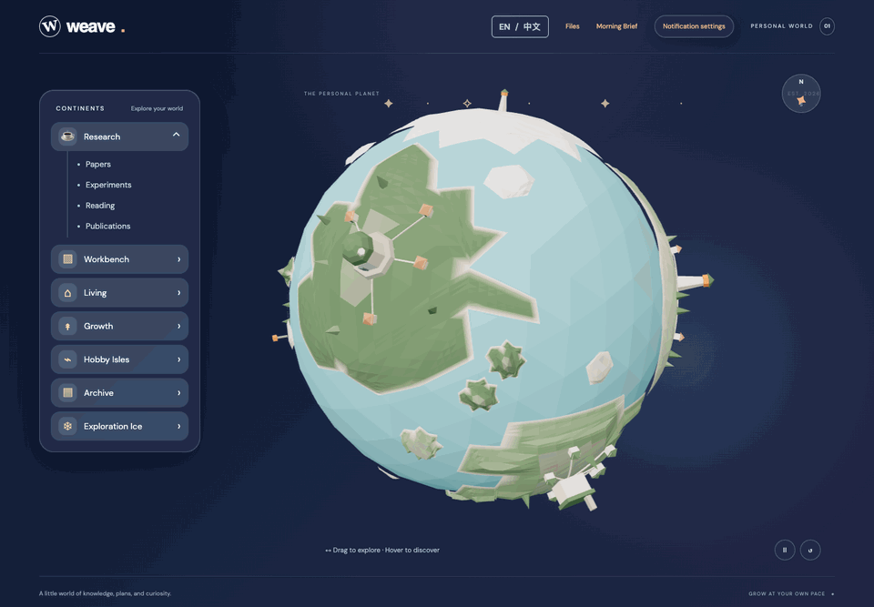
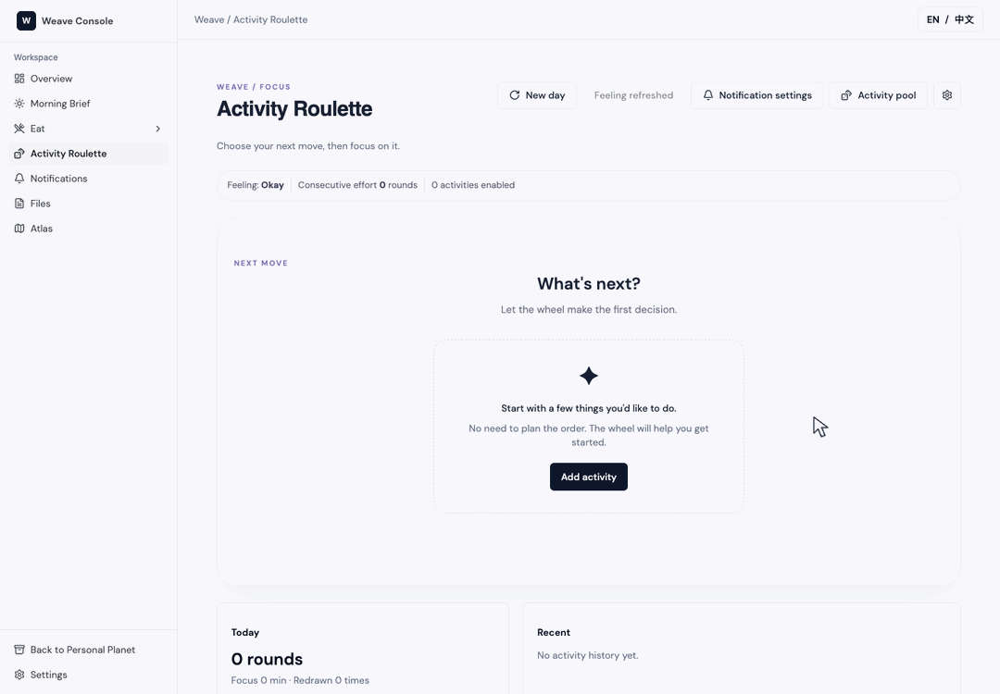

# Weave

[日本語](README.md) · **English** · [简体中文](README.zh-CN.md)

Weave is an experimental project for my own use. I'm using it to explore the things below, and anything else I want to do:

- **[Personal Planet](#personal-planet)**: An interactive 3D planet that shows the different areas of research, work, and life.
- **[Activity Roulette](#activity-roulette)**: Draws your next activity based on fatigue, balancing focus and rest.
- **[Knowledge Backend](#knowledge-backend)**: Keeps file versions and uses keyword and vector search to find content again, along with its source.

## Personal Planet

The planet has eight regions with low-poly terrain and geometric landmarks. Each region stands for progress in an important part of life: the bigger the territory and the more trees, the further along it is.
The plan is for each skill I unlock to expand the territory and grow more trees, so I can see my knowledge map expand.

For now, the planet is mainly for visual exploration. Full navigation from regions to their content isn't connected yet.

## Activity Roulette

Add work, study, and relaxing activities to the pool. The roulette draws what to do next based on fatigue and which activities are available, then sets the length of the round within the remaining time budget.

What makes it fun:

1. Once your tasks are added, draw one and get a random duration. If it's short, it feels like getting a good deal. If it's long, you get a reward break after finishing it.
2. After completing a few rounds of work or study in a row, rest is more likely to come up in the next draw.

## Knowledge Backend

For managing all kinds of files and what's in them. Sometimes I only remember that I saved something relevant, not what the file was called. I want to find it again by its content, then see where it originally came from.

It's a standalone service built on **FastAPI, PostgreSQL, and pgvector**, with file storage and text indexing handled separately:

- **File storage**: Upload original files and keep earlier versions.
- **Text ingestion**: Split text into chunks, generate embeddings, and store them in the database.
- **Search**: Rank results by combining keyword and vector scores, returning the content with its source.

It isn't connected to the frontend Files page yet; for now it's used through its own API. See the [backend guide](backend/README.md).

## Things I'd like to do later

These are ideas for the future:

- A new note grows into a tree in its region, and a finished project becomes a landmark.
- Small paths connect related records, so the links between pieces of knowledge show up on the map.
- Drag a timeline back to the planet from a month ago and pick up ideas I had set aside.

## Learn more

- [More features](docs/features.md): Atlas design maps, Morning Brief, Eat, and notifications.
- [Frontend development](frontend/README.md) · [Knowledge backend](backend/README.md) · [Architecture](docs/architecture.md)

The interface can switch between English and Simplified Chinese, and your language preference is saved in the current browser.
