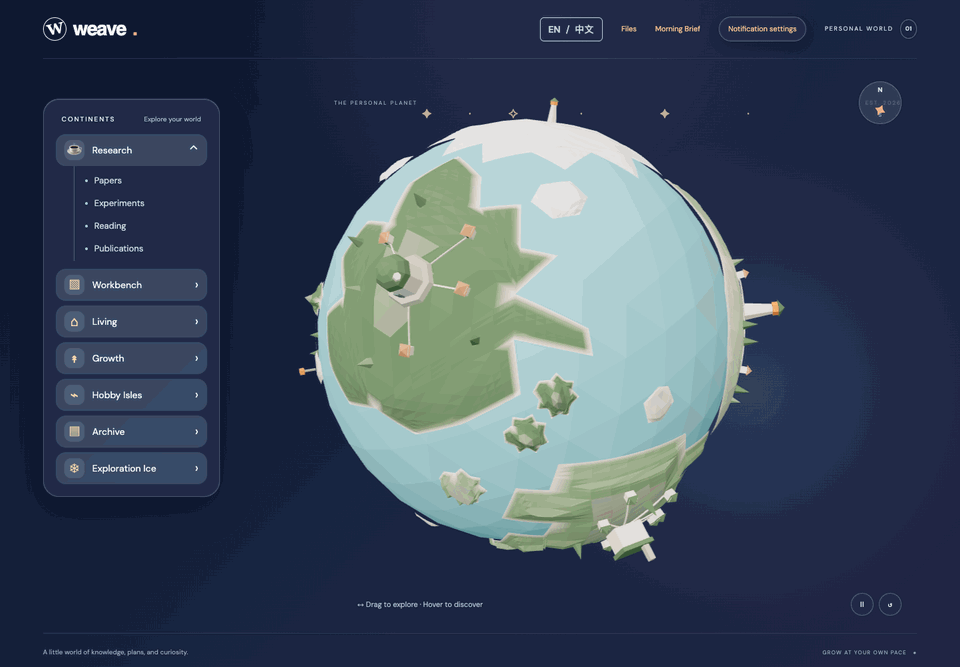
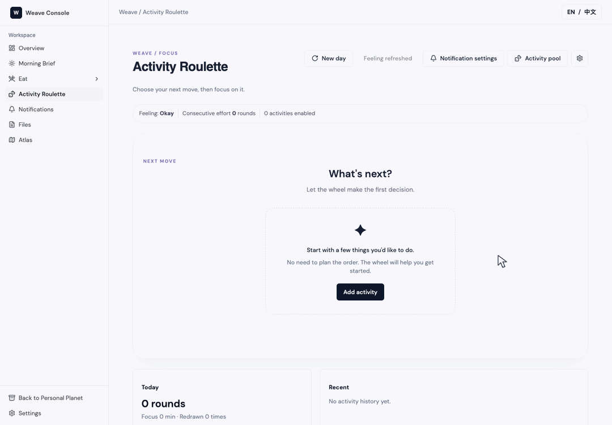

# Weave

**日本語** · [English](README.en.md) · [简体中文](README.zh-CN.md)

Weave は個人用の実験プロジェクトです。下のようなことに加えて、自分がやりたいことは何でも試しています。

- **[パーソナルプラネット](#パーソナルプラネット)**：操作できる3Dの星で、研究・仕事・生活のさまざまな領域を表します。
- **[アクティビティルーレット](#アクティビティルーレット)**：疲れ具合をもとに次の活動を抽選し、集中と休憩を組み立てます。
- **[ナレッジバックエンド](#ナレッジバックエンド)**：ファイルのバージョンを残し、キーワード検索とベクトル検索で内容と出典を探し出します。

## パーソナルプラネット

8つのエリアに、ローポリの地形と幾何学的なランドマークがあります。それぞれが人生の大切な分野の進み具合を表していて、領地が広く、木が多いほど進んでいる、という設計です。
スキルを一つ解放するたびに領地が広がり、木が増えていく。そうやって知識の地図が広がっていく様子が見える星を目指しています。

今はまだ主にビジュアル面を探っている段階です。エリアからコンテンツへの本格的なナビゲーションは、まだつながっていません。

## アクティビティルーレット

仕事、勉強、リラックスの活動をプールに入れます。疲れ具合と実行できる活動をもとに次にやることを抽選し、残り時間の範囲内でそのラウンドの長さを決めます。

面白いところ：

1. タスクを入れて抽選すると、時間もランダムで決まります。短い時間が出たら、ちょっと得した気分。長い時間が出たら、終わった後にご褒美の休憩時間がもらえます。
2. 仕事や勉強を何ラウンドか続けて完了すると、次に休憩が出やすくなります。

## ナレッジバックエンド

いろいろなファイルの情報を管理するためのものです。前に関係ありそうな内容を保存したことは覚えているのに、ファイル名が思い出せない。そんなとき、内容から探し出して、それがもともとどこから来たのかも確認できるようにしたいと思っています。

**FastAPI、PostgreSQL、pgvector** を使った独立したサービスで、ファイル保存とテキストの索引作成を分けて扱います。

- **ファイル保存**：元のファイルをアップロードし、過去のバージョンも残します。
- **テキスト取り込み**：テキストを分割し、埋め込みベクトルを生成してデータベースに保存します。
- **検索**：キーワードとベクトルのスコアを組み合わせて順位を付け、内容と出典を返します。

フロントエンドの Files ページには、まだ接続していません。今は独立した API から使います。詳しくは[バックエンドの説明（英語）](backend/README.md)をご覧ください。

## これからやってみたいこと

今後の構想です。

- 新しいノートが対応するエリアで一本の木に育ち、完成したプロジェクトがランドマークになる。
- 関連する記録の間に小道をつなぎ、知識同士のつながりを地図上に表す。
- タイムラインをドラッグして1か月前の星に戻り、あのとき置きっぱなしにしたアイデアを拾い直す。

## もっと見る

- [その他の機能（英語）](docs/features.md)：Atlas の設計マップ、Morning Brief、Eat、通知など。
- [フロントエンド開発](frontend/README.md) · [ナレッジバックエンド](backend/README.md) · [アーキテクチャ](docs/architecture.md)（各リンク先は英語）

アプリの表示言語は英語と簡体字中国語に切り替えられます。選んだ言語は、このブラウザに保存されます。
