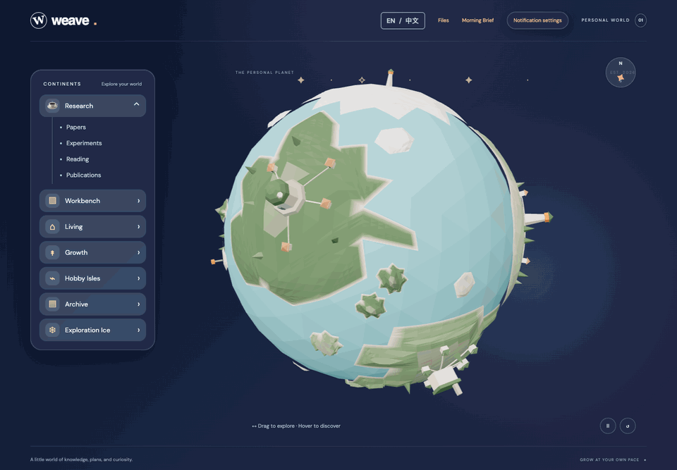
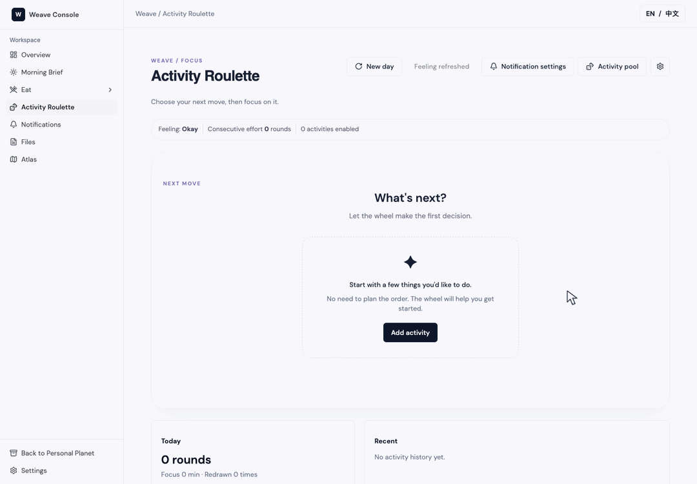

# Weave

[日本語](README.md) · [English](README.en.md) · **简体中文**

Weave 是一个面向个人使用的实验项目，探索以下事情和任何我想做的事情：

- **[个人星球](#个人星球)**：用一颗可交互的三维星球，呈现研究、工作和生活的不同领域。
- **[活动转盘](#活动转盘)**：结合疲劳状态抽取下一项活动，安排专注与休息。
- **[知识后端](#知识后端)**：保存文件版本，用关键词与向量检索找回内容和来源。

## 个人星球

这里有八个区域、低多边形地形和几何地标，代表每一个人生重要部分的进展，领土面积越大，树越多，代表进度越高。
每一个点亮的技能点都会在地图上扩大领土面积，长出更多树，代表知识版图的扩张。

目前主要用于视觉探索，完整的区域内容导航尚未接通。

## 活动转盘

把工作、学习和放松加入活动池，根据疲劳状态和可用活动抽取下一步，并在剩余时间预算内安排本轮时长。
有趣的地方：
1. 添加好任务以后进行抽选，可抽到随机时长的任务。如果时间短，会觉得赚了，如果时间长，完成以后会有奖励的休息时间。
2. 连续完成几轮工作或学习后，下一次抽到休息的权重会增加。

## 知识后端
用于管理各种文件信息。有时只记得以前存过一段相关内容，却忘了文件叫什么。希望能按内容找回来，再看到它原来出自哪里。

基于 **FastAPI、PostgreSQL 和 pgvector** 的独立服务，文件保存与文本索引分别处理：

- **文件保存**：上传原文件，保留历史版本。
- **文本入库**：分块、生成嵌入向量，保存到数据库。
- **内容检索**：结合关键词与向量评分排序，返回内容及对应来源。

尚未接入前端 Files 页面，目前通过独立接口使用。详见[后端说明](backend/README.md)。

## 以后想做的

以下是未来设想：

- 新笔记在对应区域长成一棵树，完成的项目变成一座地标。
- 在相关记录之间连起小路，让知识之间的联系出现在地图上。
- 拖动时间轴，回到一个月前的星球，找回当时搁下的想法。

## 继续了解

- [更多功能](docs/features.zh-CN.md)：Atlas 设计地图、晨报、Eat 与通知。
- [前端开发](frontend/README.md) · [知识后端](backend/README.md) · [架构说明](docs/architecture.md)

界面支持中英文切换，语言偏好保存在当前浏览器。
