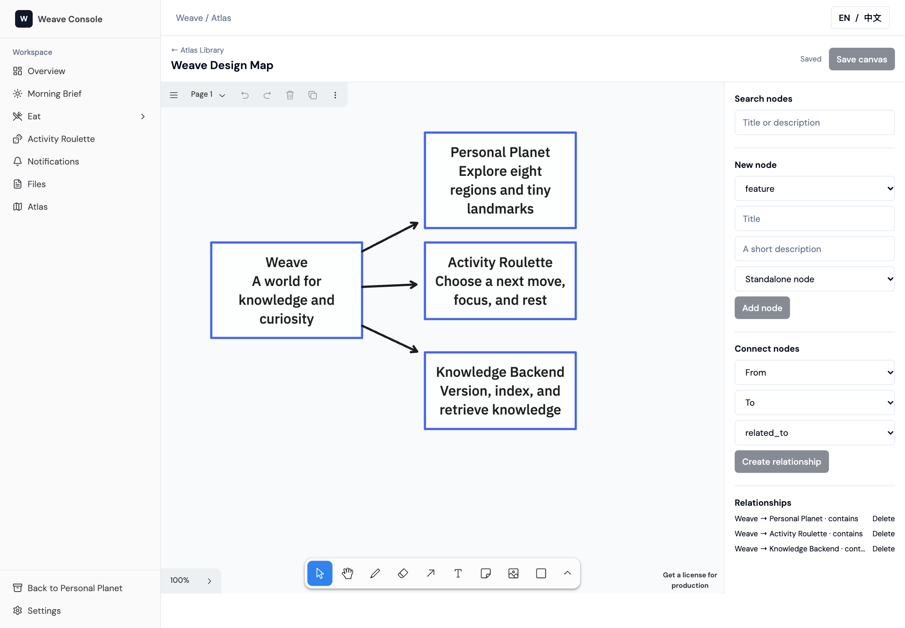

# Features & demo guide

[← Back to Weave](../README.md)

**English** · [简体中文](features.zh-CN.md)

“Implemented” means the code exists in this repository; some modules require configured services.

## Main features

| Module | What it does | Current status |
| --- | --- | --- |
| **Personal Planet** | Eight-region 3D world, drag rotation, hover feedback, pause and reset | Requires WebGL; full region-to-content navigation is not connected |
| **Activity Roulette** | Work / study / rest pools, fatigue-aware selection, focus and break timers, pause and history | Browser storage in development; D1 in production |
| **Knowledge Backend** | Original files and versions, text extraction utilities, chunking, embeddings, hybrid retrieval with source references | Independent Python + PostgreSQL / pgvector service; not connected to the Files UI |

## More experiments

| Module | What it does | Current status |
| --- | --- | --- |
| **Atlas** | Searchable map library, example maps, typed nodes and relationships, hierarchy, folding and saved canvases | tldraw + D1 |
| **Morning Brief** | AI-generated briefs, source links, editable text, guided regeneration, history and push | Requires OpenAI and D1; scheduled by the Worker |
| **Eat** | Three daily menu candidates, actual meal records, ratings, recipes and categories | D1; AI recommendations require OpenAI |
| **Files** | Example file list with filename / project search | Mock data in the Console |
| **Notifications & settings** | Web Push subscriptions, test notifications, Morning Brief and Daily Recipe switches | D1 + VAPID; delivery requires device testing |

The Worker has scheduled entry points for Morning Brief at 06:30 JST and Daily Recipe at 18:00 JST. The local Next.js dev server does not execute cloud schedules.

## Demo guide

Start the frontend, then visit these paths on `http://127.0.0.1:3000`:

| Scene | Path | Try it |
| --- | --- | --- |
| Explore the planet | `/` | Drag, hover a region, then pause or reset the view |
| Pick your next activity | `/console/study` | Add activities, draw a round, and try the timer |
| Browse the workspace | `/console` | Explore the module navigation and narrow-screen sidebar |
| Map a design | `/console/atlas` | Initialize local D1, add the included examples, edit and save a map |
| Browse example files | `/console/files` | Search by filename or project |
| Try AI workflows | `/console/morning-brief`, `/console/eat` | Configure the required services before generating content |

For the independent knowledge backend, see the [backend setup and API examples](../backend/README.md). It is not a frontend route.

## More screens

## Data & demo boundaries

- The app supports English and Simplified Chinese. Use the language control on the planet homepage or Console header; the preference is saved in this browser. README language links switch documentation separately. The main screenshots show the English UI.
- Screenshots come from local runs: Atlas shows a locally created English demo map and Activity Roulette uses demo activities. No personal production data is shown.
- File upload and indexing are separate in the knowledge backend. Upload endpoints store originals and versions; they do not automatically extract or index them. Text ingestion via the document-creation endpoint or Markdown/TXT script has its own chunking and embedding flow.
- Multi-format extraction utilities exist, but the complete upload-to-search workflow is not wired into the frontend. The README diagram describes the code flow; it is not evidence of a live database or embedding-service test.
