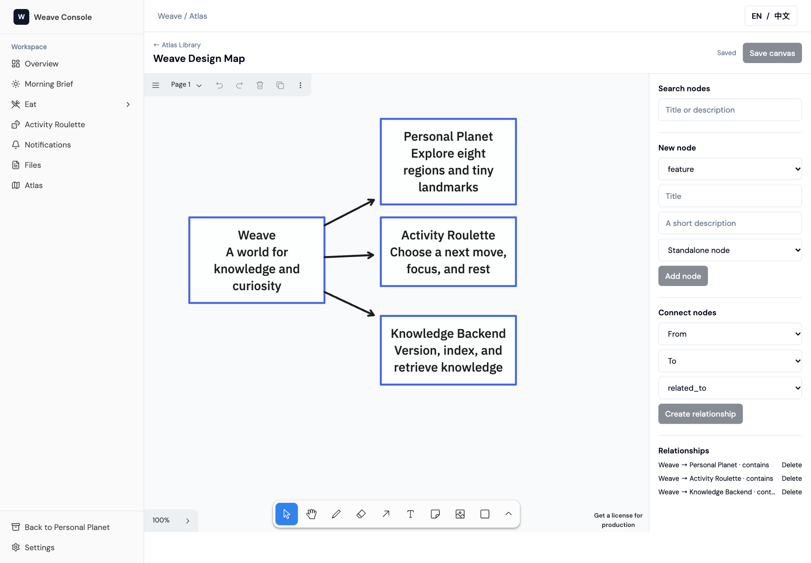

# 功能与展示说明

[← 返回 Weave](../README.zh-CN.md)

[English](features.md) · **简体中文**

这里的“已实现”指仓库中已有对应代码，不代表所有功能都能在零配置环境下使用。

| 模块 | 已实现的能力 | 当前状态与依赖 |
| --- | --- | --- |
| **Personal Planet** | 八区域三维星球、拖动旋转、悬停反馈、暂停与视角重置 | 可本地展示；需要 WebGL，完整区域路由尚未接通 |
| **Atlas** | 地图库、搜索与标签、示例图、节点和关系编辑、层级折叠、画布保存 | 使用 tldraw；持久化依赖 Cloudflare D1 |
| **Morning Brief** | AI 生成晨报、来源链接、正文编辑、补充要求后重新生成、历史记录与推送 | 依赖 OpenAI、D1；定时任务由 Worker 执行 |
| **Eat** | 每日三组候选推荐、切换候选、实际用餐记录、评分、食谱与分类管理 | 依赖 D1；AI 推荐需 OpenAI，结合近期用餐与季节信息 |
| **活动转盘** | 工作／学习／放松活动池、随机抽取、专注与休息计时、暂停、疲劳状态与历史统计 | 开发模式使用浏览器本地存储；生产模式使用 D1 |
| **Files** | 示例文件列表、按文件名或项目搜索 | 当前 Console 使用 mock 数据，尚未接入真实文件后端 |
| **通知与设置** | Web Push 订阅、测试通知、晨报和每日食谱功能开关 | 依赖 D1 与 VAPID 配置；实际送达需设备验证 |
| **独立知识后端** | 原文件上传与版本管理、多格式文本提取、文本分块、嵌入与检索接口 | Python + PostgreSQL / pgvector；尚未与 Files 界面贯通 |

晨报与每日食谱已配置 Worker 定时入口，分别对应日本时间 06:30 和 18:00；本地 Next.js 开发服务不会自动执行云端定时任务。

## 展示导览

启动前端后，可按以下顺序体验。表中的路径均相对于本地服务 `http://127.0.0.1:3000`。

| 展示场景 | 页面路径 | 建议体验 |
| --- | --- | --- |
| **探索个人世界** | `/` | 拖动星球，悬停区域，对比地形和地标，再暂停或重置视角 |
| **浏览功能入口** | `/console` | 查看工作台结构，切换不同模块，体验窄屏侧栏 |
| **组织设计关系** | `/console/atlas` | 配置本地 D1 后添加示例图，打开画布，编辑节点、连接关系并保存 |
| **决定下一步活动** | `/console/study` | 添加活动、设置时间、抽取一轮，体验专注、暂停与休息状态 |
| **浏览文件界面** | `/console/files` | 搜索示例文件，观察列表的信息层次 |
| **体验 AI 工作流** | `/console/morning-brief`、`/console/eat` | 配置服务后体验生成、编辑或反馈，再查看保存的历史 |

## 更多界面

## 数据与展示边界

- 系统支持英文和简体中文：星球首页和 Console 顶栏均可切换，并在当前浏览器记住偏好。README 的文档切换独立于系统设置，主要截图展示英文界面。
- 截图来自本地运行：Atlas 使用本地创建的英文演示地图，活动转盘使用演示活动，未连接线上个人数据。
- 知识后端的原文件上传与索引是分开的。上传接口保存文件和版本，不会自动提取文本或建立检索索引；文本入库接口及 Markdown/TXT 入库脚本有独立的分块与嵌入流程。
- 知识后端的文本提取模块支持多种格式，但完整的上传到检索流程尚未接入前端。README 流程图是代码链路说明，不代表本次已验证数据库或真实嵌入调用。
